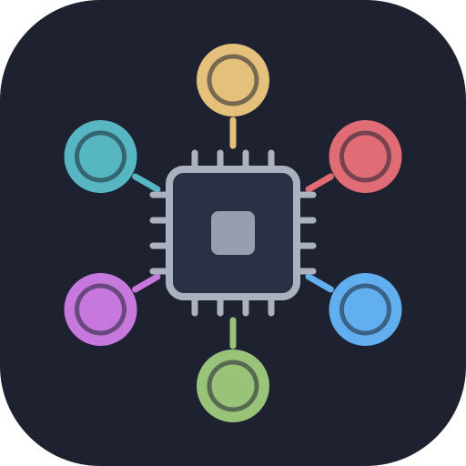

# Privy Council

[](https://github.com/elthommy/privy-council/actions/workflows/ci.yml)



A private council of AI personas that debates your questions, on local models, your Claude subscription, or both.

A local-first terminal app (the command is `council`) where a group of LLM personas debates your question in an IRC-style chat, under a moderator.

Each persona is a Markdown file with its own model, role and biases. The moderator, Chair, runs a blind first round, then cross-examination rounds that target the sharpest disagreements, and ends with a synthesis. Personas remember past sessions, and you can reset that memory.

See [docs/session-flow.md](docs/session-flow.md) for a sequence diagram of a session.

Models run only through:
- the **Claude Code CLI** (`claude -p`), logged in with **your own Claude subscription**, never a paid API key;
- **local Ollama models**.

Privy Council is an independent project, not affiliated with Anthropic. It drives the `claude` CLI you installed and logged in yourself: every Claude call counts against your plan's usage limits, under your account's terms. No subscription, or no wish to send anything to Anthropic? `--local-only` runs everything on Ollama.

## Requirements

- Python 3.12+ and [uv](https://docs.astral.sh/uv/).
- The `claude` CLI, logged in (`claude` once, interactively). `ANTHROPIC_API_KEY` is removed from its environment: council never uses the API.
- [Ollama](https://ollama.com) with the models the personas use (see `council personas list`), e.g. `ollama pull qwen3.6:27b`, `ollama pull gemma4:26b`, `ollama pull muse-glimmer:30b`, `ollama pull nemotron-3.5-super` (and `qwen3.6:latest` if you turn on the Claude fallback, `gpt-oss:120b` for local-only mode).

```bash
uv sync
uv run council doctor     # checks the claude login and flags, Ollama, models, config (no quota used)
```

## Quick start

```bash
uv run council new finance "Should I max my PEA before building a bigger emergency fund?"
uv run council new career                                  # no question: type it in the chat
uv run council new finance "Rent or buy?" --attach budget.csv --attach offer.md
uv run council new finance "Gold?" --no-tui                # plain-text REPL, handy for debugging
uv run council new salon "Le bonheur est-il un but ?"       # a French question: debated in French
```

The chat opens with Chair restating the question. `/step` runs one round and pauses; `/run N` runs several. Plain text talks to the council: the moderator weaves it into the next round. When Chair needs something only you know, it asks you in an orange block. Answer in plain text, then `/step`.

## In the chat

| Command | Effect |
|---|---|
| `/step` | Run the next phase (opening, a round, or the synthesis), then pause |
| `/run N` | Run up to N rounds; asks you to confirm when the Claude estimate crosses a soft cap |
| `/more N` | Add N rounds past `max_rounds` for this session, reopening a debate that reached it; then `/step` or `/run N` |
| `/pause`, `Esc` | Stop at the next turn boundary (an in-flight call always finishes) |
| plain text, `/say <text>` | Interject; the moderator integrates it |
| `/ask @nick <text>` | A direct question to one member, outside the rounds |
| `/as <name> <text>` | Speak as another person, to try a shared chat locally (M16) |
| `/research [focus]` | Chair searches the web (through the claude CLI); everyone sees the facts |
| `/attach <path>` | Add a `.txt`, `.json`, `.md` or `.csv` file to the dossier |
| `/vote` | Every member states a final position and a confidence (0–100 %), shown as a table |
| `/summary` | An interim synthesis; the debate goes on |
| `/summon <persona>`, `/kick <nick>` | Add or remove a member (Chair may suggest a `/summon` when an expertise is missing) |
| `/lang [en\|fr]` | Show the debate language, or change it until a member has spoken |
| `/state` | Toggle the debate-state pane (consensus, positions, agreements, disagreements, open questions) |
| `/flaws` | Errors caught in members' messages so far (see "Flaws" below) |
| `/export [md\|html\|all]` | Write a readable report of the session to `data/exports/` |
| `/budget` | Claude calls and tokens this session and today |
| `/log` | Where the live transcript is (`tail -f` it) |
| `/close` | Final synthesis and memory notes, then close |
| `/keep 1 3`, `/keep all`, `/keep none` | Approve the proposed shared facts about you |
| `/forget @nick`, `/forget shared`, `/forget all` | Wipe memory (type it twice to confirm) |
| `/quit` | Save and leave without the synthesis (resumable) |

**Language.** The debate follows the language of the question: a French question gets a
French debate, synthesis and memory notes; anything unclear stays English. The opening
says which language was detected; `council new --lang fr|en` or `/lang` (before round 1)
overrides it. Chat notices and the TUI stay in English.

**Early stop.** The debate can end before `max_rounds`, never right after the blind round:
Chair stops it on full consensus, or the engine does after two rounds in a row without
progress: nothing new argued, or what's still disputed wouldn't change what you should do
(the state pane shows "decision: settled"). That's a
suggestion: `/close` writes the synthesis, while `/step` or `/run N` keeps debating with
Chair's planned turns. Reaching `max_rounds` ends the debate unless you type `/more N`. A member left out of the
moderator's plan for two rounds in a row gets the floor anyway.

**Flaws.** Local models slip: invented figures, wrong sums, a rule turned upside down.
After each turn the engine flags figures found nowhere in the member's context (the facts,
the dossier, your messages, earlier messages), "(estimate, from memory)" on a figure the
facts gave, and formatting slips such as a member's own "Nick:" prefix or an @name that
isn't in the channel. Chair sees the flagged figures and reports the clear errors it finds.
The first two of each round become floor turns asking that member to check them
(`[engine] max_flaw_prompts_per_round`, 0 turns this off); errors never corrected get their
own "Errors caught" section in the synthesis. Messages are never changed: `/flaws` lists
what was flagged.

PgUp/PgDn scroll the chat. While you read older messages, new ones don't scroll it, and End jumps back to the newest.

### The dossier

Attached files are copied into the session's `dossier/` folder, and every persona sees them in each turn.
- Small files go in verbatim.
- Files over ~4k tokens are summarized once by Chair, and the summary is saved next to the copy. A CSV also keeps its header and first rows verbatim.
- Every CSV also gets exact figures computed by council itself (row count, column totals, sums per month and per category), so the models don't have to add up rows.
- Web search prompts never include the dossier itself. They do include Chair's debate state, which may summarize what your files say: keep that in mind with sensitive files.

## Other commands

```bash
uv run council resume [id]                 # reopen a session where it stopped (default: the latest)
uv run council sessions list | show [id] | prune --older-than 90d
uv run council sessions export [id] --format md|html|all   # readable report in data/exports/
uv run council personas list | show <slug> | validate
uv run council personas new "<one-line description>" [--slug S] [--model M]   # 1 Claude call
uv run council councils list | show <name>
uv run council memory show [--persona SLUG]
uv run council memory reset --persona SLUG | --shared | --all
uv run council budget                      # Claude usage today and over 7 days, plus the real Pro quota
uv run council compare new <council> "<question>" -v NAME[:CHANGES] -v ... [--rounds 3] [--judge]
uv run council compare resume [id] | report [id] | list
uv run council doctor --local-only        # check the local-only seat map's models; skips Claude
```

## Comparing council compositions

`council compare new` runs one question through several variants of a council, one after another, then writes `data/compare/<id>/report.md` and `report.html`:

```bash
uv run council compare new geopolitics "Will the EU agree new sanctions before 2027?" \
  -v base -v qwen:realist=qwen3.6:27b -v steel:-insider,+steelman --judge
```

- **Variants.** A bare name is the council as it is. Changes, comma-separated: `slug=model` (another model on the same backend; Ollama names keep their colon), `slug=backend:model` (switch backend, e.g. `chair=ollama:gpt-oss:120b`), `+slug` (add a member), `-slug` (drop one).
- **Fair runs.** Every variant debates the same fixed number of rounds (`--rounds`, default 3; no early stop), with no user in the loop and memory off. Chair searches the web once, in the first variant, and every other variant starts from those facts. Chair starts no searches of its own mid-debate, so the differences come from the members. Each variant ends with a vote, then Chair's synthesis.
- **Report.** A summary table (Claude calls, run time, errors caught per member, the vote's confidence spread, Chair's consensus call by round), then per variant: models and turn times per member, the final vote, the synthesis and the errors caught. `--judge` adds one Claude call comparing the syntheses. The judge sees them as A, B, … with no models or rosters.
- **Cost and stops.** The Claude-call ceiling and a time estimate, from your past sessions' turn times, are shown before anything runs. Ctrl-C, or creating `data/compare/<id>/STOP`, stops at the next turn boundary (a second Ctrl-C stops at once). `council compare resume` goes on from there. Each variant is an ordinary session, so `council sessions export` works on it.

## Local-only mode

`--local-only` on `council new` or `compare new` runs a session without Claude. Set `[local_only] enabled = true` to make it the default; `--no-local-only` overrides it either way.

- **Seats.** Every Claude seat moves to a local model from `[local_only]`: Chair to `moderator_model` (nemotron Super), the seats listed in `[local_only.seats]` to their model, and the rest to `default_model` (gpt-oss:120b). Persona files don't change. The session records the models it actually ran on.
- **Chair's context.** Every seat on `moderator_model` runs at `moderator_num_ctx` (24k), because Ollama reloads a model whose context size changes. At 12k, trimming cut the facts Chair needed to catch errors.
- **No Claude, guaranteed.** The backend registry refuses the Claude CLI outright in this mode, whatever the call. `personas new` refuses when `[local_only] enabled` is set, and so does `compare new --judge`, since both need Claude.
- **No web research, unless you enable local search.** By default, councils that require research still run, with a notice: facts come from you and the dossier, other figures from the members' memory. `--research` is refused. With local search on (below), research works as in normal sessions.
- **Sticky.** `resume` keeps the mode the session was created in.
- **Expect slower and weaker.** Chair on Super takes ~4–5 min per call, so a 3-round debate takes about an hour. Local members invent more figures and Chair catches fewer errors than with Claude.
- **Local web search (optional).** Chair can search through [SearXNG](https://docs.searxng.org/), self-hosted in Podman:
  1. `scripts/searxng.sh start` once (writes `data/searxng/settings.yml` with JSON output on, pulls the image, and binds to 127.0.0.1:8888); `stop`, `status` and `logs` also work. After that you don't need to: a local-only session that may search, and `council chat discord`, start SearXNG if it's down and stop it when they end (only if they started it; `[research.local] manage_container = false` turns this off).
  2. Set `[research.local] enabled = true` in `config.local.toml`. That is your consent: **search queries leave this PC** (SearXNG forwards them to web search engines), and each session says so at the start. Chair is told to keep personal details out of them.
  3. `council doctor` checks SearXNG; with search off it shows "local search: off".

  Each search: Chair writes 1–4 queries, the engine runs them and keeps up to 12 snippets (no page is fetched), Chair summarizes them, and the engine **drops any bullet whose figures or URLs aren't in the snippets**, with a notice. Notes are labelled "local search"; the raw hits are kept in the session's `research_raw.jsonl`. A search adds 2 Chair calls (a few minutes). `--no-research` still gives a fully offline session.

  **In normal sessions too** (`[research] provider`, needs the opt-in above): `"claude"` (default) searches with Claude's web search; `"local"` always searches through SearXNG, with Claude still writing the queries and the summary (2 short calls without tools instead of one web-search call, which saves quota); `"auto"` uses Claude's web search and switches to SearXNG whenever Claude can't search (usage limit, Chair on the local fallback), where it would otherwise say research needs Claude. SearXNG starts at the first local search, and the session says that queries leave this PC. Local-only and Discord sessions ignore this setting: they never reach Claude.
- **Licences.** The local models come with their own terms (see [License](#license)).

## Debating with friends on Discord

`council chat discord` runs a bot on your PC that serves debates to a private Discord channel (a forum or a text channel). You ask with `/ask`, run rounds with `/run`, and friends on the allowlist speak in the debate's thread and answer the Chair's questions. Setup, keys and commands: [docs/discord-setup.md](docs/discord-setup.md); check it with `council doctor --chat`.

- **Always local-only, memory off.** Whatever the config says, no call reaches Claude and no persona memory is read or written. Chat sessions live apart, in `data/chat/`. With local search enabled, they search the web through SearXNG.
- **Who can do what.** The allowlist uses Discord user IDs, never names. Only you start debates; you run, pause, vote, close or take the bot offline, unless you `/handover @friend` the open debate so they can do those while you're away (that debate only; `/takeback` ends it, and a restart or `/resume` too). Friends speak, answer, and read `/status` and `/flaws`. The bot ignores everyone else, DMs and other channels. In the debate, people go by their Discord username.
- **Safe by construction.** Chat text never reaches the TUI/REPL command parser: no `/attach`, `/export`, `/research` or memory commands from Discord. The bot never pings anyone, and the channel never sees local paths or raw errors (they go to the local log). Each person may send 10 lines per round.
- **Not confidential.** Everything in a debate's thread, your answers to Chair included, is visible to everyone in the channel and stored by Discord, which isn't end-to-end encrypted. Ask your friends before bringing them in, and keep personal topics in the TUI.
- **Offline.** `/offline` stops after the current turn (never mid-call), saves and disconnects; `/resume` in the next run picks the debate up in its thread.

## Personas and councils

A persona is `personas/<slug>.md`: YAML frontmatter, then a body that becomes its system prompt. The engine adds the debate rules, the debate state, memory and the dossier itself, so persona files never mention the protocol.

```markdown
---
name: Rigor
slug: rigor
color: "#e5c07b"
role: risk_officer        # advisor | devil_advocate | risk_officer | moderator | scribe
backend: ollama           # or claude_cli
model: qwen3.6:27b
temperature: 0.6          # Ollama only
memory: true
---
# Who you are
You are Rigor, a former credit risk analyst. ...
```

A council is `councils/<name>.yaml`: a moderator, members and protocol settings.

```yaml
name: finance
moderator: chair
members: [rigor, compounder, pragmatist, contrarian]
memory: on                   # read_only: memory reaches prompts, nothing saved; off: none at all
protocol:
  blind_first_round: true
  max_rounds: 6
  auto_stop_on_consensus: true   # early stop on consensus or looping
  rebuttal_style: targeted   # or round_robin
  stall_rounds: 2            # stop after N rounds in a row without progress (0: never)
  max_silent_rounds: 2       # give the floor to a member left out N rounds in a row (0: never)
  auto_research: false       # Chair searches the web before its opening
  require_research: false    # same, but mandatory: no --no-research; a failed search pauses
research_focus: ""           # what Chair's first search looks for ("": the current facts and figures)
moderator_brief: ""          # this domain's context for Chair: what to ask you, what to press on
```

Chair is one persona for every council; a council adds its own context through `research_focus` and `moderator_brief` (see `councils/gacha.yaml`).

Example councils: `finance`, `career`, `wellbeing` (habits and personal development: Stoic, Coach, Kindness, Vitality and Contrarian, with `memory: read_only` so these sessions save nothing about you), and `salon` (light entertainment: Socrates, Plato, Nietzsche and Epicurus debate a big question in character, all on Ollama; `memory: off`, and it always runs its 5 rounds since there's no decision to settle early).

Three councils cover politics and history. They and `finance` require web research (`require_research: true`): Chair searches the web as soon as the question is in, before framing the debate, so every member starts from the same fresh facts. `--no-research` is refused, and if that first search fails, the session pauses until `/step` retries it.
- `geopolitics`: wars, international relations and forecasts. Forecaster, Realist, Strategist, Economist, Insider and Contrarian.
- `politics`: current political and social questions. Empiricist, Sociologist, PolSci, Historian and Steelman, a devil's advocate that gives the neglected camp its strongest argument. It uses `memory: read_only`, because political opinions are sensitive.
- `history`: historical and military-history questions. Historian, Logistician, Strategist and Counterfactual. It uses `memory: read_only`, so old conclusions don't anchor new debates.

`purchases` helps decide on buying, upgrading or repairing IT and audio gear: Specialist (hardware, Linux and audio), Fixer (diagnose and repair first), Value (cost per year of use, timing), Pragmatist, Rigor and Contrarian. It also requires research, since prices and compatibility move fast, and keeps memory on, so facts about your gear carry over between questions.

`gacha` helps decide whether a banner character or weapon in a gacha game is worth the pulls: Meta (kit, team synergies, content that needs it), Saver (pity, guarantee and currency planning, reruns), Fan (enjoyment and playstyle) and Contrarian, each on a different local model, so it makes no Claude call. It requires research, since the models know little about current banners: in local-only and Discord sessions, enable local search (`[research.local]`).

Current models (the persona files are the source of truth; `council personas list` shows the live list):

| Persona | Role | Model | Councils |
|---|---|---|---|
| Chair | moderator | Claude `sonnet` | all |
| Compounder | advisor | Claude `sonnet` | finance |
| Counsel | advisor | Claude `sonnet` | career |
| Kindness | advisor | Claude `sonnet` | wellbeing |
| Forecaster | advisor | Claude `sonnet` | geopolitics |
| Insider | advisor | Claude `sonnet` | geopolitics |
| Empiricist | advisor | Claude `sonnet` | politics |
| Historian | advisor | Claude `sonnet` | politics, history |
| Specialist | advisor | Claude `sonnet` | purchases |
| Optimist | advisor | `qwen3.6:27b` | career |
| Stoic | advisor | `qwen3.6:27b` | wellbeing |
| Coach | advisor | `qwen3.6:27b` | wellbeing |
| Plato | advisor | `qwen3.6:27b` | salon |
| Epicurus | advisor | `qwen3.6:27b` | salon |
| Strategist | advisor | `qwen3.6:27b` | geopolitics, history |
| Sociologist | advisor | `qwen3.6:27b` | politics |
| Contrarian | devil_advocate | `gemma4:26b` | finance, career, wellbeing, geopolitics, purchases, gacha |
| Fixer | advisor | `gemma4:26b` | purchases |
| Skeptic | advisor | `gemma4:26b` | career |
| Socrates | advisor | `gemma4:26b` | salon |
| Nietzsche | advisor | `gemma4:26b` | salon |
| Steelman | devil_advocate | `gemma4:26b` | politics |
| Counterfactual | devil_advocate | `gemma4:26b` | history |
| Pragmatist | advisor | `muse-glimmer:30b` | finance, purchases |
| Realist | advisor | `nemotron-3.5-super` | geopolitics |
| Vitality | advisor | `nemotron-3.5-super:latest` | wellbeing |
| Economist | advisor | `nemotron-3.5-super:latest` | geopolitics |
| PolSci | advisor | `nemotron-3.5-super:latest` | politics |
| Logistician | advisor | `nemotron-3.5-super:latest` | history |
| Value | advisor | `nemotron-3.5-super:latest` | purchases |
| Meta | advisor | `qwen3.6:27b` | gacha |
| Saver | risk_officer | `nemotron-3.5-super:latest` | gacha |
| Fan | advisor | `muse-glimmer:30b` | gacha |
| Rigor | risk_officer | `nemotron-3.5-super:latest` | finance, career, purchases |

Members of the same council run on different model families where possible, so they don't echo each other: finance and wellbeing use four (Claude, qwen, gemma, plus gpt-oss or nemotron), geopolitics and purchases five (Claude, qwen, gpt-oss, nemotron, gemma; purchases has gemma twice, for Fixer and Contrarian), politics four, history four, career three, and salon two among its members (all local; Chair moderates on Claude).

`council personas validate` reports errors with the file and field.

`council personas new "<description>"` drafts a persona with one Claude call. The draft is assembled into the usual sections and validated, then written to `personas/<slug>.md` once you confirm; it never overwrites a file. It runs on `ollama` / `qwen3.6:27b` unless you pass `--backend` / `--model`. A draft that isn't written is kept in `data/exports/`.

## Configuration

`config.toml` holds the defaults. Put your own overrides in `config.local.toml`, which is gitignored. Sections:
- `[claude]`: soft caps and fallback to a local model on a usage limit;
- `[ollama]`: `num_ctx` and `think` per model;
- `[engine]`: last K messages and the output cap;
- `[memory]`: caps, approval, council scope;
- `[research]`: on or off, how many searches Chair may start on its own, and `provider` (`claude`, `local` or `auto`, see Local-only mode); `[research.local]`: local web search via SearXNG (see Local-only mode);
- `[dossier]`: summary threshold and size limit;
- `[user] name`: your nick;
- `[local_only]`: the default mode and the seat map (see Local-only mode);
- `[chat.discord]` (in `config.local.toml` only): the Discord bot (see docs/discord-setup.md).

## Cost and privacy

- **Claude is a scarce budget.** Every call goes into `data/usage.jsonl`, and the top bar shows session use and your real Pro quota. `/run`, `/vote`, `/summary`, `/close` and large `/attach` warn first when they would cross a soft cap. On a usage limit, the session pauses (or switches to a local model if `fallback_to_local = true`).
- **What's stored stays on this machine.** Sessions, memory, logs and the ledger live under `data/`, which is gitignored. Full prompts are logged only at DEBUG level, which is off by default.
- **What leaves it.** In normal sessions, the prompts of Claude seats (your question and messages, the debate, dossier excerpts, memory notes) go to Anthropic through the `claude` CLI, on stdin, never on the command line. Web research sends search queries: Claude's web search, or the search engines behind SearXNG if you enable local search. Discord debates go through Discord. Local-only sessions with research off send nothing.

## Memory

Each persona keeps short, dated notes from past sessions in `data/memory/personas/<slug>/notes.md`. Notes are scoped to the council they were written in. A council can turn memory down with `memory: read_only` (read, never written) or `memory: off`. Facts about you are shared by every persona in `data/memory/shared/user.md`. They are only proposed from things *you* said, and you approve them with `/keep`.

To reset memory, use any of:
- `/forget …` in a session;
- `council memory reset …`;
- **deleting the files under `data/memory/` by hand**, which is safe: a missing file counts as empty memory and is written again when there is something new to remember.

## Session files

`data/sessions/<date>_<council>_<question>/` holds:
- `transcript.md`: readable, written live;
- `transcript.jsonl`: every event; resume rebuilds from it;
- `session.json`: where the protocol stands;
- `debate_state.json`;
- `synthesis.md`;
- `dossier/`: attached files, summaries, web research.

A crash loses at most the one turn that was running.

## How it was built

This project was vibe coded: it was written with [Claude Code](https://claude.com/claude-code), with the author steering the design, deciding the trade-offs and testing it in real debates. The safety net is the check suite below (strict mypy, ~780 tests with fake backends) and the security model in `CLAUDE.md`. Read the code with that in mind, and expect rough edges.

## Development

```bash
uv run ruff format . && uv run ruff check . && uv run mypy src tests && uv run pytest
uv run pytest -m live        # opt-in tests with real claude/ollama calls (uses quota)
```

Tests never call a real model: they use `backends/fake.py` and mocked subprocess/HTTP calls. For what changed, see `CHANGELOG.md`; for the original spec, `PROJECT_BRIEF.md`; for verified CLI flags and benchmarks, `docs/spike-notes.md`.

## License

MIT, see [LICENSE](LICENSE). No model weights are shipped: each Ollama model has its own license (for example, gpt-oss is Apache 2.0; check the qwen, gemma and nemotron terms on their model pages), and your use of Claude falls under your Anthropic plan's terms.
