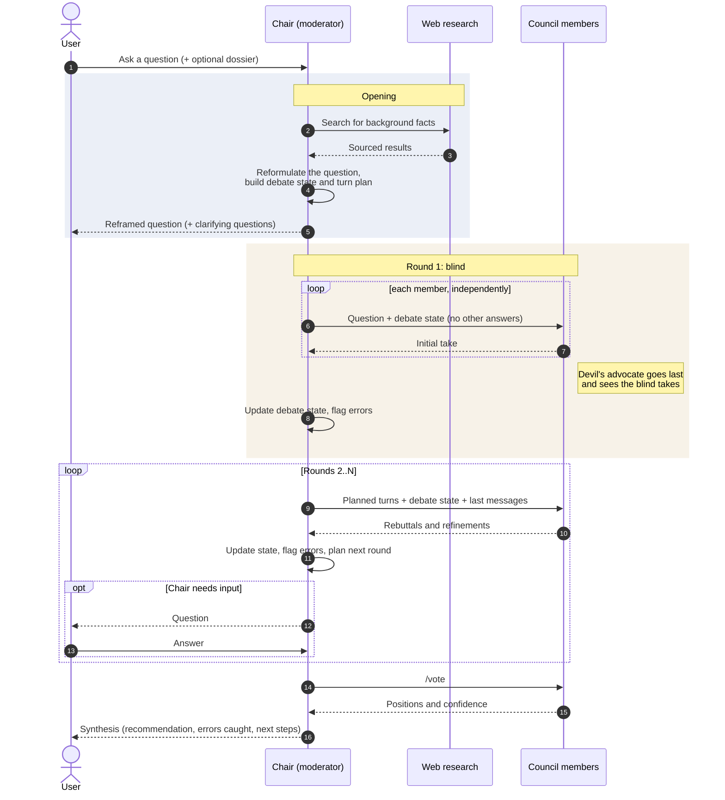
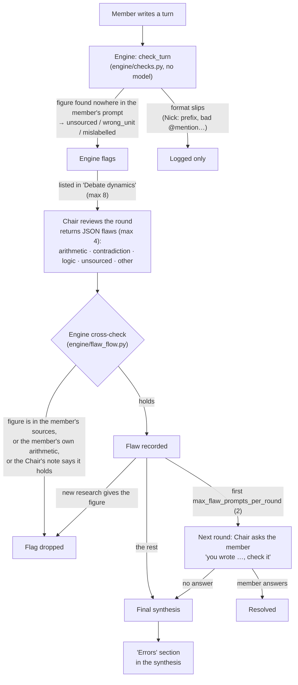

# Session flow

A standard council session, at a high level. Pause/resume, memory, the budget
checks and `/summon` are left out.

## Error checks

What "flag errors" does above. The engine's checks are plain Python
(`engine/checks.py`, no model call). They only test where a figure comes from:
whether it is in the member's own prompt or the member's own arithmetic on figures
from the same turn. Wrong sums, contradictions and logic errors are judged by the
Chair alone. The engine then drops the Chair's reports that don't hold up. A
flagged turn's text is never changed.

`/flaws` lists every flag, from both the engine and the Chair.
