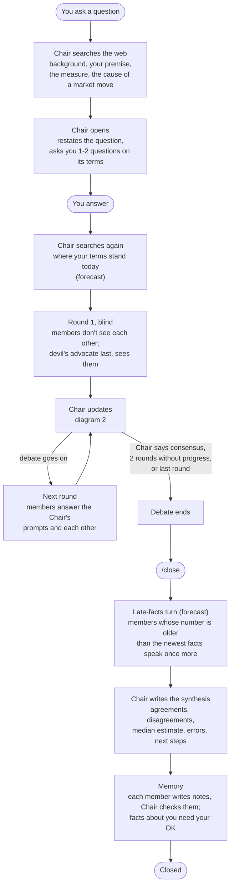
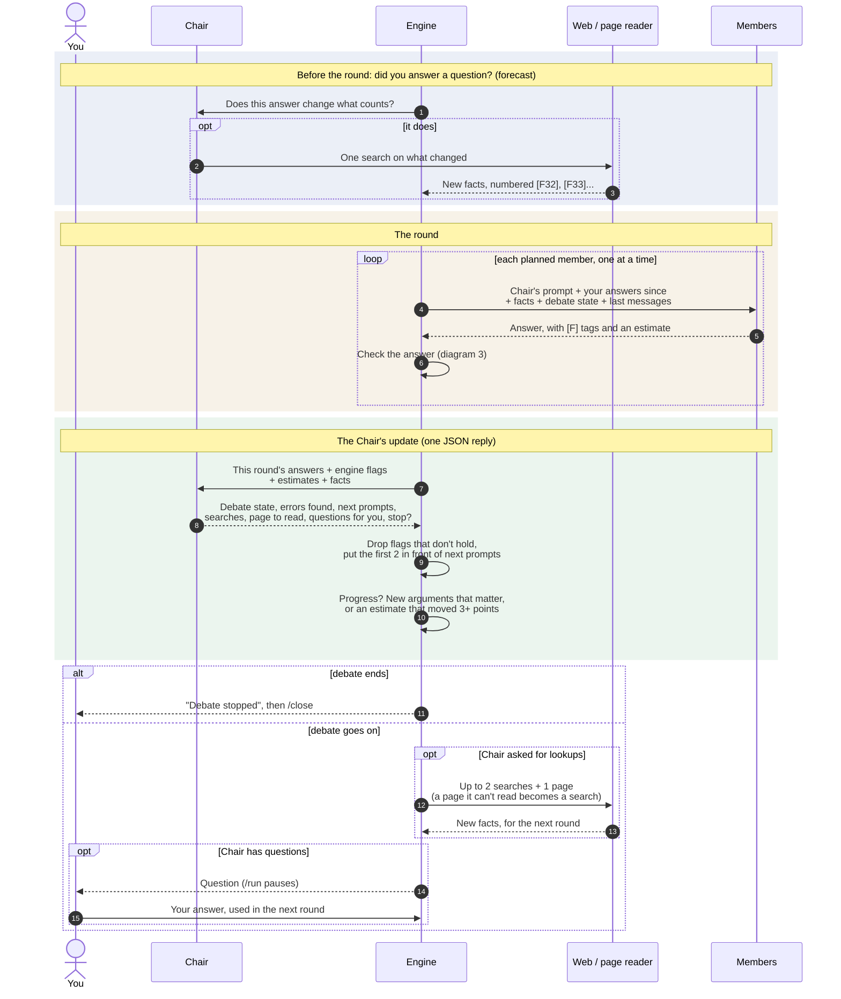
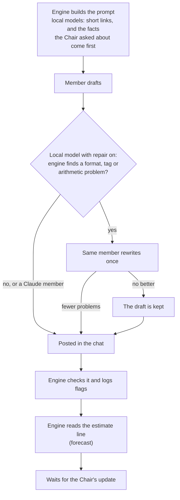
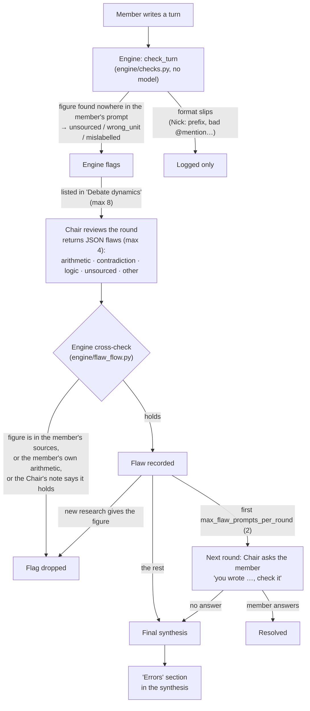

# Session flow

Three diagrams, from far to near: the whole session, one round, one member's turn.
The steps marked *forecast* run only in councils with `estimate: probability`
(economics, geopolitics). "Engine" is plain Python: it calls no model itself, it
decides who is called and checks what comes back. Budget checks, `/summon`, pausing
and the Discord front end are left out.

## 1. The whole session

## 2. One round (2 and later)

The engine ends a debate after `stall_rounds` (2) rounds without progress, but gives it
one more round if the Chair had just asked for a lookup that would really run.

## 3. One member's turn

## Error checks

What "flag errors" does above. The engine's checks are plain Python
(`engine/checks.py`, no model call). They only test where a figure comes from:
whether it is in the member's own prompt or the member's own arithmetic on figures
from the same turn. Wrong sums, contradictions and logic errors are judged by the
Chair alone. The engine then drops the Chair's reports that don't hold up. A posted
turn is never changed; only a local member's unposted draft can be (diagram 3).

`/flaws` lists every flag, from both the engine and the Chair.
